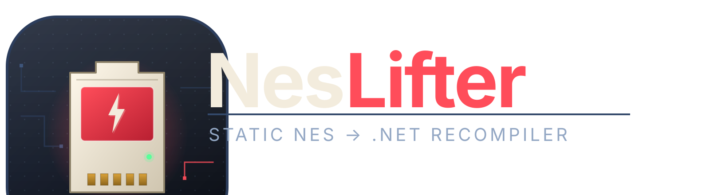
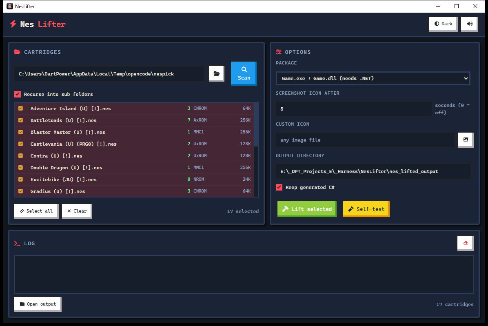
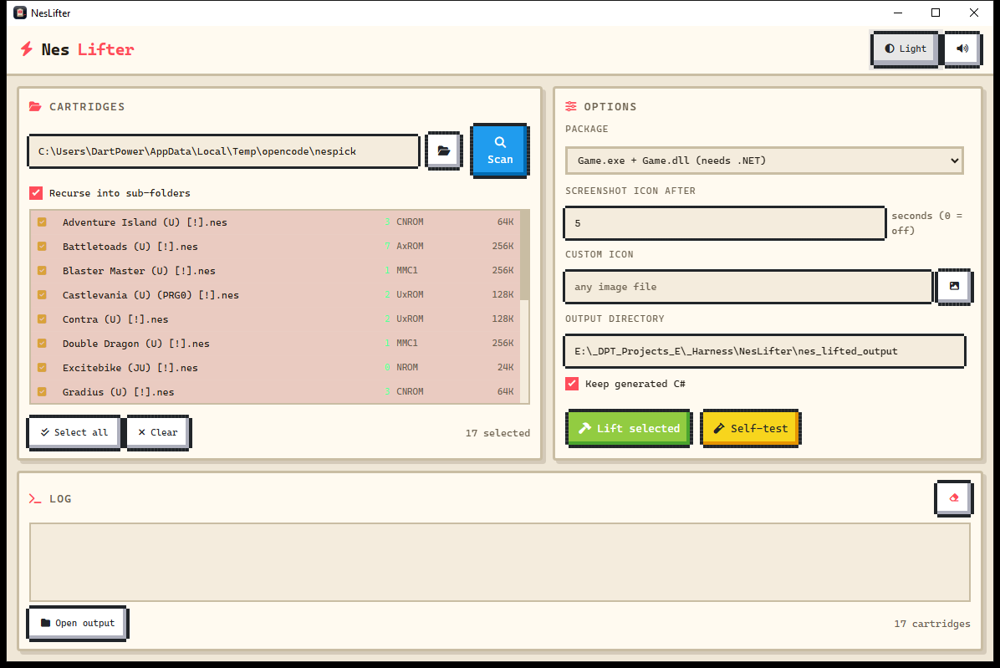
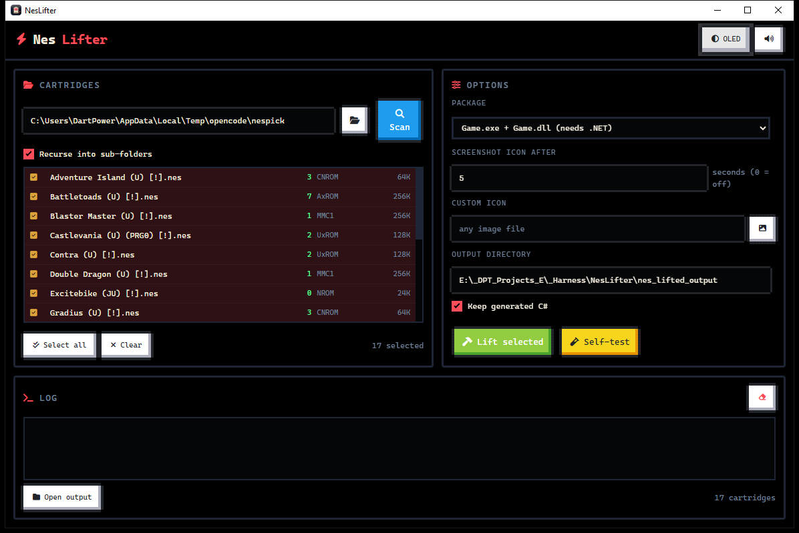

<div align="center">



**Static NES → .NET recompiler.** Feed it a `.nes` file, get a runnable .NET game and readable C#.

[](https://github.com/dpteam/NesLifter/actions/workflows/ci.yml)
[](https://dotnet.microsoft.com/)
[](#requirements)
[](LICENSE)
[](#supported-mappers)

</div>

---

## What it does

NesLifter reads an iNES / NES 2.0 image, disassembles the 6502 program, and
translates every reachable instruction into equivalent C#. The result is
compiled with Roslyn into a self-contained .NET assembly that renders with
WinForms and plays through `winmm`.

There is no 6502 interpreter in the hot path: control flow becomes real C#
`goto` labels, and a dispatch table handles `RTS`/`RTI`/indirect jumps. An
interpreter fallback still exists, but only for addresses the static analysis
could not prove reachable — and it reports them back so the next lift can
inline them.

```
   game.nes
      │
      ├─ iNES / NES 2.0 header ──────────► mapper, mirroring, RAM sizes, CRC32
      │
      ├─ Board.Power() ──────────────────► power-on bank layout
      │
      ├─ recursive-descent 6502 analyser ► instructions, labels, functions
      │                                    (decoding through the real bank map)
      │
      ├─ Lifter ─────────────────────────► C# : CPU, PPU, APU, mapper, WinForms
      │
      └─ Roslyn / dotnet publish ────────► game.exe + game.dll (+ icon)
```

## Quick start

```powershell
git clone https://github.com/dpteam/NesLifter.git
cd NesLifter
dotnet build

# Just run it: the GUI opens (falls back to a terminal UI where WebView2 is missing).
dotnet run

# Prove the whole toolchain works. No ROM needed.
dotnet run -- --selftest

# Or stay on the command line.
dotnet run -- "Super Mario Bros. (World).nes" --full-exe
```

<div align="center">

</div>

## Interfaces

NesLifter has three front ends over the same pipeline. Pick whichever fits:

| Interface | Launch | Best for |
|---|---|---|
| **GUI** | `NesLifter` (or `--gui`) | picking a folder, watching a batch, reading the report |
| **TUI** | `NesLifter` in a terminal when WebView2 is unavailable | servers, SSH, remote desktop without GPU |
| **CLI** | `NesLifter <rom> [options]` | scripts, CI, one-off lifts |

With no arguments NesLifter opens the GUI; if the WebView2 runtime is missing it
falls back to the TUI, and if the console cannot host a full-screen UI it falls
back to plain line mode. Explicit arguments always skip all of that and behave
exactly like the CLI always has.

### GUI

A WinForms host with an embedded Chromium view, styled with
[NES.css](https://nostalgic-css.github.io/NES.css/) and Font Awesome — both
vendored under `web/vendor`, so it works with no network at all.

- browse or type a folder path; cartridges are listed with mapper, board and
  size, unsupported mappers flagged in red
- tick the ones you want (supported ones are pre-selected)
- choose package mode, screenshot-icon delay, custom icon, output directory
- press **Lift selected** and watch the log stream live
- **Self-test** runs the whole mapper matrix from inside the GUI

Three themes, cycled with the button or **F2**:

| Light | OLED |
|---|---|
|  |  |

The interface also has optional **soft mathematical audio**: short, quiet,
synthesised cues (pentatonic, low-passed, 220 ms max) for selection, start,
success and failure. No samples, no chiptune, off by default.

### TUI

A full-screen terminal UI with the same capabilities: menu, cartridge browser
with mapper columns, options, live log, results. Arrow keys move, Space selects,
Enter acts, Esc backs out. It degrades to plain line mode automatically when the
console is redirected or `TERM=dumb`.

```
  NESLIFTER  ·  Cartridges
  ▶ [x] Adventure Island (U) [!].nes      3  CNROM     64K
    [x] Battletoads (U) [!].nes            7  AxROM    256K
    [ ] Aladdin (Mapper 4).nes             4  MMC3     256K
```

`--selftest` builds synthetic cartridges for sixteen mapper families, lifts
them, compiles them, then executes each generated assembly headlessly and
checks it reaches a frame budget without trapping:

```
  PASS  nrom-32k              mapper 0    -> headless: frames=28 instructions=187527
  PASS  mmc1-256k-chrram      mapper 1    -> headless: frames=23 instructions=154991
  PASS  mmc3-256k-chr         mapper 4    -> headless: frames=24 instructions=164331
  PASS  vrc6-128k-chr         mapper 24   -> headless: frames=15 instructions=103877
  ...
Self-test passed: 16/16 cartridges lifted and executed.
```

## Requirements

| | |
|---|---|
| OS | Windows 10 / 11 (the generated game uses WinForms and `winmm`) |
| SDK | .NET 10 SDK |
| Runtime | .NET 10 Desktop Runtime (to *run* a generated game) |
| GUI | Microsoft Edge WebView2 Runtime (preinstalled on Windows 11) |

No third-party native dependencies. NuGet packages: `Microsoft.CodeAnalysis.CSharp`
for compilation and `Microsoft.Web.WebView2` for the GUI.

The GUI forces Chromium's software rendering path, so it also works over remote
desktop and inside a VM. If the WebView2 runtime is absent the tool falls back to
the terminal UI automatically — nothing breaks.

## Command line

```
NesLifter <rom.nes|folder> [options]
NesLifter --selftest [options]
```

| Option | Description |
|---|---|
| `--gui` | Force the WebView2 GUI |
| `--no-tui`, `--cli` | Never start an interactive UI |
| `-i, --input <path>` | Input `.nes` file or folder |
| `-o, --output <dir>` | Output directory (default `nes_lifted_output`) |
| `-r, --recursive` | Recurse into sub-folders |
| `--no-compile` | Generate C# only, skip compilation |
| `--no-source` | Do not keep the generated C# |
| `--keep-source` | Keep the generated C# (default) |
| `-v, --verbose` | Verbose pipeline output, PDB paths, diagnostics |
| `--exe` | `Game.exe` + `Game.dll` (default) |
| `--dll` | Only `Game.dll`, run with `dotnet Game.dll` |
| `--full-exe` | Self-contained single `.exe`, no .NET needed (~50 MB) |
| `--icon <image>` | Use this image as the game icon (any format) |
| `--capture-icon <n>` | Let the game screenshot itself after `n` seconds (default 5) |
| `--no-icon` | Do not capture a screenshot icon |
| `--selftest` | Lift + compile + execute synthetic ROMs for every mapper |
| `--frames <n>` | Frame budget for `--selftest` execution (default 30) |
| `--no-run` | Compile but do not execute during `--selftest` |
| `--keep` | Keep `--selftest` artifacts |
| `--version` | Version and supported mapper list |
| `-h, --help` | Help |

Generated games accept their own flags:

```powershell
Game.exe                            # windowed
Game.exe --headless 600             # 600 frames, no window, exit code 0 on success
Game.exe --capture-icon 5           # screenshot itself as the game icon
Game.exe --icon-out my.ico          # write the icon somewhere specific
Game.exe --icon-exit                # quit right after the icon is written
```

## Packaging

Three shapes, chosen at lift time:

| Flag | Output | Needs .NET? | Size |
|---|---|---|---|
| `--exe` *(default)* | `Game.exe` + `Game.dll` + deps/runtimeconfig | yes | ~1 MB |
| `--dll` | `Game.dll` only | yes (`dotnet Game.dll`) | ~300 KB |
| `--full-exe` | one self-contained `Game.exe` | **no** | ~50 MB |

`--exe` is the normal .NET 5+ desktop layout, so the game is double-clickable.
`--full-exe` bundles the runtime and works on a machine with nothing installed,
which is worth the size when you want to hand someone a game.

Both `.exe` modes go through `dotnet publish`, so the SDK does the apphost
binding and the icon embedding; NesLifter never hand-patches PE headers.

## Game icons

Every generated game can carry its own face:

```powershell
# Let the game pick its own icon from its title screen.
NesLifter game.nes --capture-icon 5

# Or supply artwork; any image format is converted to a multi-resolution ICO.
NesLifter game.nes --icon cover.png
```

With `--capture-icon`, the game samples its framebuffer for the given number of
seconds, scores each frame by colour variety and coverage, and keeps the most
interesting one — so a fade-in or a blinking cursor does not become the icon.
The result is written to `Game.icon.ico` next to the game and embedded into the
`.exe` on the **next** lift, so re-lifting a title gives it a permanent icon.

Icons are written at 16, 20, 24, 32, 40, 48, 64, 128 and 256 px; Windows picks
the closest size for Explorer, the taskbar and Alt-Tab.

## Output layout

```
nes_lifted_output/
└── Super Mario Bros. (W) [!]/
    ├── Super Mario Bros. (W) [!].exe            # double-click to play
    ├── Super Mario Bros. (W) [!].dll            # the lifted game
    ├── Super Mario Bros. (W) [!].deps.json
    ├── Super Mario Bros. (W) [!].runtimeconfig.json
    ├── Super Mario Bros. (W) [!].icon.ico       # captured from the running game
    ├── analysis.txt                             # mapper, vectors, coverage
    ├── dynamic_targets.txt                      # manually forced addresses
    ├── dynamic_targets.log                      # runtime-discovered addresses
    └── src/
        └── Game.generated.cs                    # the generated C#
```

`analysis.txt` is the first place to look when a game misbehaves:

```
[Cartridge]
Mapper         : 4 (MMC3)
Mapper support : full
Board summary  : 8 KB PRG / 1-2 KB CHR banking, scanline IRQ, 4 mirroring modes.
Mirroring      : vertical
[Analysis]
Entry         : 0x8000
Instructions  : 18142
Code bytes    : 61204 (74.7% of PRG)
Unknown ops   : 0
Indirect jumps: 37
```

## Supported mappers

Analysis and runtime emission are generated from the same descriptor, so a
mapper cannot be half-supported.

| # | Board | Notes |
|---|---|---|
| 0 | NROM | fixed 16/32 KB PRG |
| 1 | MMC1 | serial shift register, 4 mirroring modes, WRAM disable |
| 2 | UxROM | 16 KB switch at `$8000`, last bank fixed |
| 3 | CNROM | 8 KB CHR banking |
| 4 | MMC3 | 8 KB PRG, 1/2 KB CHR, scanline IRQ, PRG/CHR swap bits |
| 7 | AxROM | 32 KB switch, single-screen mirroring |
| 9 | MMC2 | latch-based CHR switching (Punch-Out!!) |
| 11 | Color Dreams | PRG + CHR from one register, bus conflicts |
| 13 | CPROM | 16 KB CHR RAM, 4 KB banking |
| 21 | VRC4a/c | 8 KB PRG, 1 KB CHR, IRQ |
| 22 | VRC2a | 16 KB PRG, 2 KB CHR |
| 23 | VRC4e/f | VRC4 variant |
| 24 | VRC6a | + 3 expansion sound channels |
| 25 | VRC4b/d | VRC4 variant |
| 26 | VRC6b | VRC6 variant |
| 34 | BNROM / NINA-001 | 32 KB PRG, optional 4 KB CHR |
| 66 | GxROM | PRG + CHR, bus conflicts |
| 69 | Sunsoft FME-7 | command banking, 1 KB CHR, IRQ, 8 KB WRAM |
| 71 | Camerica | UxROM + mirroring bit, bus conflicts |
| 79 | NINA-03/06 | fixed PRG, CHR banking, mirroring bit |
| 87 | Jaleco CHR | fixed PRG, CHR banking |
| 88 | Namco 118 | fixed PRG, CHR banking, mirroring |
| 206 | Namco 118 / DxROM | MMC3 clone without IRQ |
| 232 | Codemasters Quattro | 4 × 128 KB blocks |

Anything else falls back to a flat PRG layout and is reported as
`Mapper support : fallback`. See [`docs/MAPPERS.md`](docs/MAPPERS.md) for the
implementation notes and the remaining gaps.

## How the generated game looks

The output is ordinary, readable C#. One label per 6502 address, one statement
per instruction, with the original disassembly in a comment:

```csharp
L8000:
{
    Runtime.LastPC = 0x8000; Runtime.TraceInstruction(0x8000);
    Runtime.InsCount++; Runtime.AdvanceCycles(7);
    if (Runtime.CheckNmi(0x8000)) goto L8100;
    if (Runtime.CheckIrq(0x8000)) { Runtime.DispatchTarget = Runtime.IrqVector; goto Dispatch; }
    // SEI
    Runtime.P = (byte)(Runtime.P | 0x04);
    goto L8001;
}
```

Because the PDB is emitted, a crash gives a real line number inside
`Game.generated.cs` instead of `<unknown>`.

## Dynamic targets

Recursive descent cannot see code reached only through a computed jump. Three
mechanisms cover that gap:

1. **`dynamic_targets.txt`** — force addresses into the analysis.
   ```
   ; 8231 / 0x8231 / $8231 all work
   8231          ; title screen setup
   ```
2. **`dynamic_targets.log`** — the generated game records every address it had
   to interpret. Re-running the lifter picks the file up and inlines them.
3. **Interpreter fallback** — anything still unknown executes in a built-in 6502
   interpreter at runtime, so the game keeps playing instead of trapping.

## Project layout

```
NesLifter.csproj
├── Core/                 cartridge model and CPU-side analysis
│   ├── InesLoader.cs     iNES / NES 2.0 parsing, CRC32
│   ├── CartInfo.cs       cartridge description
│   ├── CartMapping.cs    page-table memory map (2 KB PRG / 1 KB CHR pages)
│   ├── ProgramImage.cs   power-on address space view for the analyser
│   ├── Cpu6502.cs        256-entry opcode table
│   ├── Disassembler.cs   recursive-descent analyser
│   └── Boards/           one board per mapper family
├── Mappers/              MapperCatalog: identity + family metadata
├── Lifting/
│   ├── Lifter.cs         emits the whole game
│   └── MapperRuntimeEmitter.cs  emits a specialised MapperStub
├── Compilation/          Roslyn wrapper, packaging (exe / self-contained)
├── Imaging/              ICO writer and PE icon embedding
├── Host/                 CLI, pipeline, self-test
│   ├── Tui/              full-screen terminal UI
│   └── Gui/              WebView2 host and message bridge
├── web/                  GUI front end (HTML/CSS/JS) + vendored NES.css
├── Common/               file helpers, synthetic ROM builder
├── tests/                xUnit tests
├── tools/Branding/       logo and icon generator
├── tools/Shot/           window screenshot tool for docs
├── assets/               SVG + PNG + ICO
└── docs/                 architecture, mappers, troubleshooting, screenshots
```
## Documentation

- [`ROADMAP.md`](ROADMAP.md) — what is done and what is next, easiest first
- [`docs/ARCHITECTURE.md`](docs/ARCHITECTURE.md) — how a lift works, stage by stage
- [`docs/MAPPERS.md`](docs/MAPPERS.md) — per-board implementation notes
- [`docs/TROUBLESHOOTING.md`](docs/TROUBLESHOOTING.md) — black screen, wrong graphics, traps
- [`CONTRIBUTING.md`](CONTRIBUTING.md) — build, test, add a mapper
- [`CHANGELOG.md`](CHANGELOG.md) — release notes

## Known limitations

- **Static bank analysis is per-pass.** Instructions are keyed by PRG offset and
  every bank is walked, but cross-bank edges are resolved at runtime through the
  dispatcher rather than proven statically. `--no-bank-analysis` restricts the
  analyser to the power-on layout if the extra passes ever hurt.
- **APU sweep and DMC are missing.** Music plays, but some effects are silent.
- **No save states, no battery save persistence yet.**
- **Windows only** for the generated game (WinForms + `winmm`).
- **`--full-exe` is slow and large.** ~25 s and ~50 MB per game, because it
  bundles the whole desktop runtime.
- **Icons need two lifts.** The game captures its icon while running, so the
  icon is embedded into the `.exe` on the next lift. Supply `--icon` to get it
  right the first time.

### Per-title status

The interpreter refuses to execute RAM, which turns what used to be silent
garbage execution into a visible trap. That is deliberate: a game that "runs"
while executing uninitialised memory is worse than one that stops and says
where.

Of the 17 reference titles used during development, 10 run cleanly and 7 trap.
The traps are analysis gaps, not packaging problems — most are a RAM jump table
read before the code that fills it has run, which is exactly the bank-tracking
work in the [roadmap](ROADMAP.md#stage-4--static-analysis-depth-next-big-win).

`Super Mario Bros. 3` is the clearest example: it dispatches to `$0001` from
`$8446`. `--no-bank-analysis` does not change it, so the gap predates bank-aware
analysis and was previously hidden.

## Legal

NesLifter contains no ROMs and no emulator BIOS files. Use it only with
cartridge images you are legally entitled to. The generated game embeds the
PRG and CHR data of the cartridge you feed it — treat that output with the same
care as the input.

## License

GPL-3.0. See [`LICENSE`](LICENSE).

<div align="center">
<sub>Previously known as <em>NES2ILRecomp</em> / <em>NesToDotNetRecompiler</em>.</sub>
</div>
